 

---

### // 01. PROFILE & ACTIVE SYSTEMS

> **Full-Stack Systems Architect & AI Researcher** based in Bengaluru, India. BCA Scholar at Christ University specializing in acoustic speech recognition, clinical LLM synthesis, and high-performance distributed web applications.

| Attribute | Details |
| :--- | :--- |
| **Flagship System** | **Praxirence** — Ambient Clinical Intelligence Platform (Healthcare AI) |
| **Core Stacks** | Python (PyTorch, FastAPI, OpenCV) • Next.js 15 / React 19 • TypeScript • Android (Native / Expo) |
| **Research Scope** | Acoustic Speech Processing • Clinical Intelligence Synthesis • Enterprise Distributed Systems |
| **Active Deployments** | **17+ verified production-grade systems** across Healthcare, FinTech, EdTech, and Commerce |
| **Operational Status** | 🟢 Actively engineering next-generation healthcare, spatial, and financial systems |

* **Ambient Clinical AI:** Engineering **Praxirence** — proprietary ambient clinical intelligence platform delivering real-time clinical care documentation and enterprise healthcare workflow automation.
* **Full-Stack Ecosystems:** Architect and maintainer of 17+ verified production-grade web applications spanning FinTech ([Credex](https://credex-sand.vercel.app/)), EdTech ([StudyArchive](https://straw-hats-7795d.web.app/), [Nexus Scholar](https://nexus-scholar-huhs.vercel.app/)), and Retail Commerce ([Roshan Enterprises](https://e-commerce-roshan-enterprises-dhn.web.app/)).
* **Specialization Matrix:** Python, Next.js 15, React 19, TypeScript, PyTorch, Whisper ASR, Mistral-7B, OpenCV, Java (Swing, JSP), FastAPI, and mobile-first responsive architecture.

---

### // 02. TECHNICAL MATRIX

#### [ PYTHON & AI / COMPUTER VISION ]

#### [ FRONTEND & SPATIAL SYSTEMS ]

#### [ BACKEND, LANGUAGES & CLOUD ]

-ED8B00?style=for-the-badge&logo=openjdk&logoColor=white)

#### [ MOBILE & REAL-TIME MEDIA ]

#### [ DESIGN & DEVELOPER WORKFLOW ]

---

### // 03. LIVE VERIFIED DEPLOYMENTS

| Project | Domain | Architectural Stack | Production Access |
| :--- | :--- | :--- | :--- |
| **Praxirence** | Healthcare AI | Ambient Clinical Intelligence Platform | [**Enterprise Portal**](https://www.mayankraj.me) |
| **[Credex](https://github.com/M20A03/Credex)** | FinTech / AI Audit | Next.js 15, React 19, TypeScript, Claude AI, Vercel | [**Launch Live System**](https://credex-sand.vercel.app/) |
| **[Portfolio 2026](https://github.com/M20A03/Portfolio)** | Spatial Engineering | Next.js 15, React 19, Radix UI, Framer Motion, Vercel | [**Launch Live System**](https://portfolio-alpha-kohl-lqt3tnm7tp.vercel.app/) |
| **[StudyArchive](https://github.com/M20A03/StudyArchive)** | Academic Collaboration | Angular 21 (SSR), TypeScript, Firebase Firestore | [**Launch Live System**](https://straw-hats-7795d.web.app/) |
| **[Nexus-Scholar](https://github.com/M20A03/Nexus-Scholar)** | University Enterprise | React 18, Python FastAPI Backend, Gemini AI Engine | [**Launch Live System**](https://nexus-scholar-huhs.vercel.app/) |
| **[Roshan Enterprises](https://github.com/M20A03/E-commerce-Online-Shopping-for-Retail-and-Wholesale)** | Retail & Wholesale | React 18, Vite, Firebase Firestore, QR Invoicing | [**Launch Live System**](https://e-commerce-roshan-enterprises-dhn.web.app/) |
| **[Fintech Neobank](https://github.com/M20A03/Fintech)** | Banking Dashboard | Vanilla ES6+, 3D Gyroscope Physics, Canvas Engine | [**Launch Live System**](https://fintech-six-pi.vercel.app/) |
| **[Sakthi Dental Clinic](https://github.com/M20A03/Sakthi-Dental-Clinic)** | Clinical Portal | React 18, Vite, Responsive Medical UX Routing | [**Launch Live System**](https://sakthi-dental-clinic-rust.vercel.app/) |

---

### // 04. GITHUB ANALYTICS & ACTIVITY

  
  

 

  

---

### // 05. OFFICIAL GITHUB ACHIEVEMENTS & TIERS

  <table>
    <tr>
      <td align="center" width="160">
        <a href="https://github.com/M20A03?tab=achievements">
          
           
          <b>Galaxy Brain</b>
           
          
           
          32 Accepted Q&amp;A Answers
        </a>
      </td>
      <td align="center" width="160">
        <a href="https://github.com/M20A03?tab=achievements">
          
           
          <b>Pair Extraordinaire</b>
           
          
           
          50+ Co-authored PRs
        </a>
      </td>
      <td align="center" width="160">
        <a href="https://github.com/M20A03?tab=achievements">
          
           
          <b>Pull Shark</b>
           
          
           
          50+ Merged Pull Requests
        </a>
      </td>
      <td align="center" width="160">
        <a href="https://github.com/M20A03?tab=achievements">
          
           
          <b>YOLO</b>
           
          
           
          Merged without review
        </a>
      </td>
      <td align="center" width="160">
        <a href="https://github.com/M20A03?tab=achievements">
          
           
          <b>Quickdraw</b>
           
          
           
          Closed issue &lt; 5 mins
        </a>
      </td>
    </tr>
  </table>

 

<b>▸ HOW TO GET MORE GITHUB BADGES & UPGRADE TO GOLD TIERS</b>

 

| Achievement Badge | Tier Requirements | Profile Status | How to Earn / Upgrade to Highest Tier |
| :--- | :--- | :--- | :--- |
| **Galaxy Brain** | Base: 2 · Bronze: 8 · Silver: 16 · **Gold: 32** | **Gold Tier (32 / 32 Answers)** | Answer developer questions in GitHub Discussions marked as the **Accepted Answer** by repository maintainers. *(Max Gold Tier attained)* |
| **Pair Extraordinaire** | Base: 1 · Bronze: 10 · Silver: 24 · **Gold: 48** | **Gold Tier (50+ Co-authored PRs)** | Author or co-author pull requests merged into default branches using `Co-authored-by: Name <email>` commit trailers. *(Max Gold Tier attained)* |
| **Pull Shark** | Base: 2 · Bronze: 16 · Silver: 128 · **Gold: 1,024** | **Bronze+ Tier (50+ Merged PRs)** | Create and merge pull requests across public open-source repositories. Continues toward Silver (128 PRs). |
| **YOLO** | Single Milestone | **Unlocked** | Merge a pull request directly without an external code review or review approval requirement. |
| **Quickdraw** | Single Milestone | **Unlocked** | Close an open issue or pull request within 5 minutes of creation. |
| **Starstruck** | Base: 16 · Bronze: 128 · Silver: 512 · **Gold: 4,096** | **In Progress** | Accumulate 16 unique stars on a single repository. Share flagship public systems like [Credex](https://github.com/M20A03/Credex) or [Portfolio](https://github.com/M20A03/Portfolio) on LinkedIn, Reddit, and developer communities. |
| **Public Sponsor** | Single Milestone | **Actionable** | Sponsor any open-source contributor or library for $1/month via GitHub Sponsors. |

---

### // 06. COMMUNICATION SIGNALS

